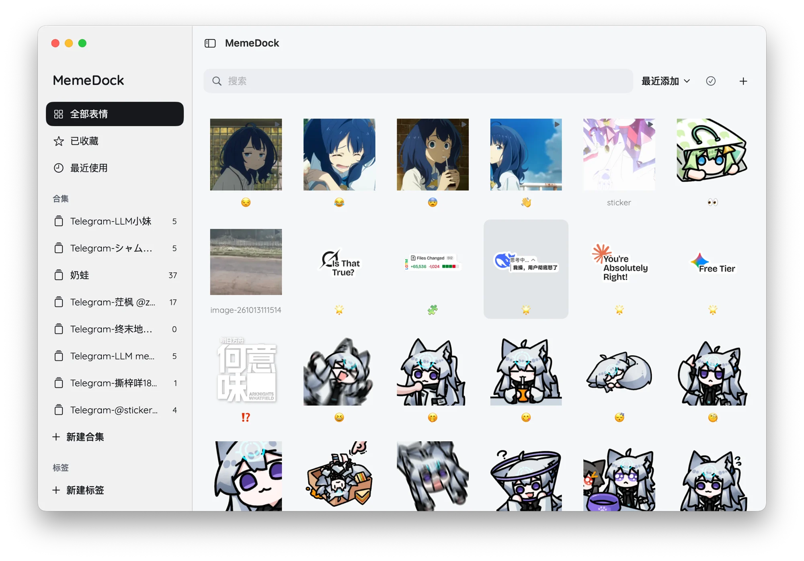
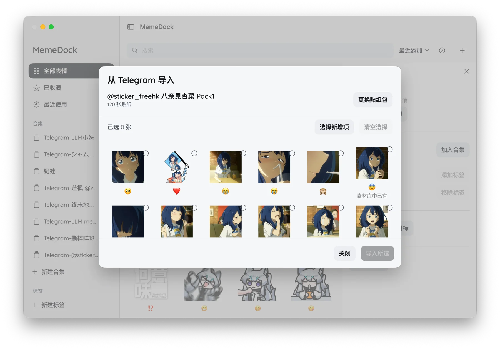
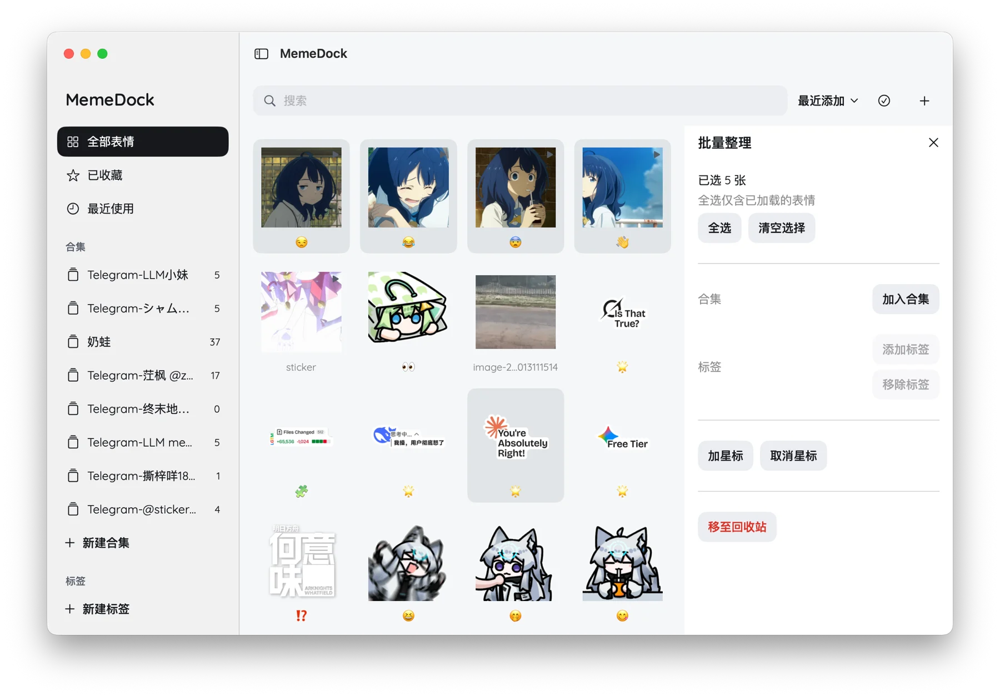
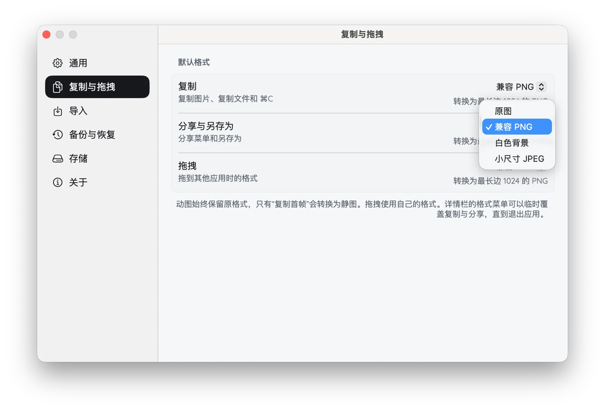
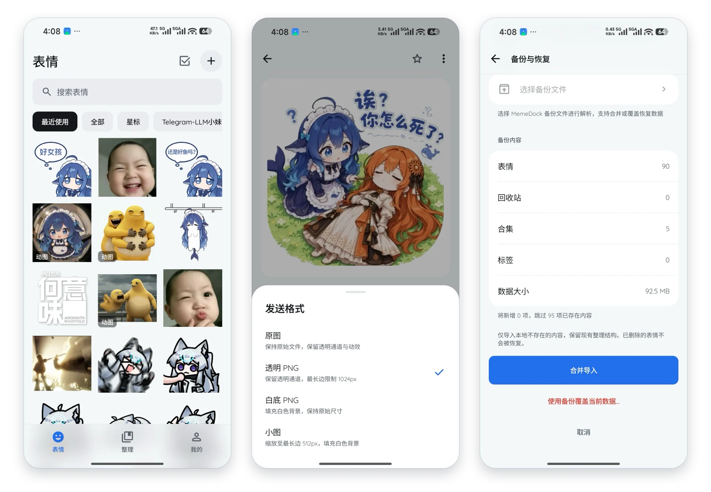

<div align="center">
  
  <h1>MemeDock</h1>
  <p><em>A quiet, local-first home for your stickers.</em></p>

  <p>
    <a href="https://github.com/grtsinry43/MemeDock/releases"></a>
    <a href="LICENSE"></a>
    
    
  </p>

  <p>
    <strong>English</strong> · <a href="README.zh-CN.md">简体中文</a>
  </p>
</div>

MemeDock is a cross-platform sticker manager built around a shared Rust core and native system interfaces. It brings scattered images and animations into a single local library—making it simple to collect, organize, and share across everyday conversations.

<div align="center">
  
</div>

## Features

- **Collect from Anywhere** — Bring in images through drag-and-drop, clipboard paste, file selection, or the Android share sheet. Browse and import **Telegram sticker packs** directly by name or link, with `.tgs` and `.webm` stickers converted into transparent animated WebP automatically.
- **Video-to-Sticker Creator** — Turn local video clips into animated WebP stickers right inside MemeDock: trim segments up to 30 seconds, crop interactively, adjust resolution (`32–512 px`), frame rate (`1–30 fps`), and quality, then preview and save straight into your library. *(Currently available on macOS and Windows; Linux and mobile support planned.)*
- **Quick Picker & Instant Paste** — Summon a lightweight sticker picker anytime from the macOS menu bar or Windows system tray with a global shortcut, search your library, and paste straight into chat apps.
- **Thoughtful Organization** — Arrange stickers with collections, tags, and stars. Reorder items freely, batch-edit selections, search by title, note, filename, or tag, and let frequently used stickers surface naturally.
- **Adaptable Sharing** — Original files remain untouched. When copying, dragging, or sharing, MemeDock prepares the right format on demand—**Best Compatibility**, **Original**, **Compatible PNG** (`1024 px`), **White Background PNG**, **Small JPEG** (`512 px`), or **Compatible GIF** (`512 px`)—with an optional **global GIF file size limit** that automatically balances resolution and frame rate for chat upload caps, plus first-frame extraction when a still image is needed.
- **Local-First & Optional Self-Hosted Sync** — Everything lives on your device in a content-addressed (`SHA-256`) library with automatic deduplication and a recoverable Trash. Back up or migrate the entire library as a single archive with preview, non-destructive merging, and snapshot-protected replacement—or pair with the optional self-hosted sync server (`memedock-server`) to keep multiple devices in sync.
- **Truly Native** — One memory-safe Rust engine (`#![forbid(unsafe_code)]`) paired with native interfaces for every platform: **SwiftUI & AppKit** on macOS, **SwiftUI** on iOS, **GTK4 & Libadwaita** on Linux, **Jetpack Compose** on Android, and **WinUI 3** on Windows. Supports instant in-app switching between English and Chinese.

## Screenshots

| Telegram Import | Batch Organization |
| :---: | :---: |
|  |  |
| **Output Presets** | **Android Client** |
|  |  |

## Installation

Prebuilt packages and `SHA256SUMS` manifests are available on [GitHub Releases](https://github.com/grtsinry43/MemeDock/releases).

- **macOS (`arm64`)**: Download `MemeDock-<version>-macos-arm64.dmg` (or `.zip`) and drag `MemeDock.app` to Applications.
- **Android (`arm64-v8a`)**: Download and install `MemeDock-<version>-android-arm64.apk`.
- **iOS (`arm64`, iOS 18+)**: Download `MemeDock-<version>-ios-arm64-unsigned.ipa`, sign it with your own Apple signing credentials, and sideload it onto your device.
- **Windows (`x64`)**: Run `MemeDock-<version>-windows-x64-setup.exe` for a per-user install, or extract `MemeDock-<version>-windows-x64.zip` for the portable build.
- **Arch Linux (`x86_64`)**: Build from `packaging/arch/memedock-bin` (prebuilt) or `packaging/arch/memedock-git` (from source) via `makepkg -si`.
- **Ubuntu 26.04+ / Fedora 44+ (`x86_64`)**: Install the DEB or RPM. Both require `gtk4 >= 4.22` and `libadwaita >= 1.9`:
  ```sh
  sudo apt install ./MemeDock-*-linux-x86_64.deb
  sudo dnf install ./MemeDock-*-linux-x86_64.rpm
  ```
- **AppImage (`x86_64`)**: Download, mark executable, and run. It bundles GTK4 and libadwaita, so the host only needs a compatible glibc.
- **Linux Bundle (`x86_64`)**: Requires `gtk4 >= 4.22` and `libadwaita >= 1.9`:
  ```sh
  sudo tar --zstd -xf MemeDock-*-linux-x86_64.tar.zst -C /
  ```

## Architecture & Development

```text
crates/domain         Validated identities, models, export & creator rules, and contracts
crates/storage        SQLite (SeaORM), atomic file staging, and content-addressed blobs
crates/core           Use cases, task scheduling, media/video pipelines, Telegram, sync, and backups
crates/ffi            UniFFI bindings and event streams for Swift, Kotlin, and C#
crates/api-contracts  Shared HTTP/sync API schemas between clients and server
apps/*                Native clients (android, ios, linux, macos, windows) and sync server (server, server-web)
```

```sh
# Workspace verification
cargo fmt --all -- --check
cargo clippy --workspace --all-targets --locked -- -D warnings
cargo test --workspace --locked

# Platform builds
cargo build --release --locked -p memedock-linux                        # Linux
cargo build --release --locked -p memedock-server                       # Self-hosted sync server
bash tools/macos/build.sh release                                       # macOS (.app)
(cd apps/android && ./gradlew :app:testDebugUnitTest :app:verifyDebugBridge) # Android
bash tools/ios/build.sh release device                                  # iOS (unsigned .app)
pwsh tools/windows/build.ps1                                            # Windows
```

## License

Released under the [MIT License](LICENSE). The bundled Quicksand typeface is licensed under the [SIL Open Font License 1.1](apps/android/app/src/main/assets/font_licenses/quicksand-OFL.txt).
