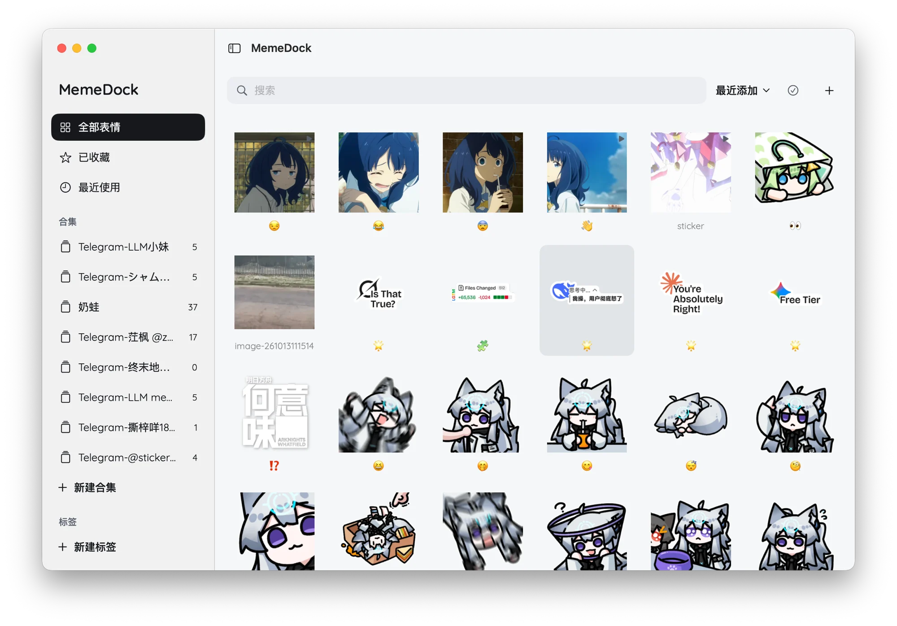
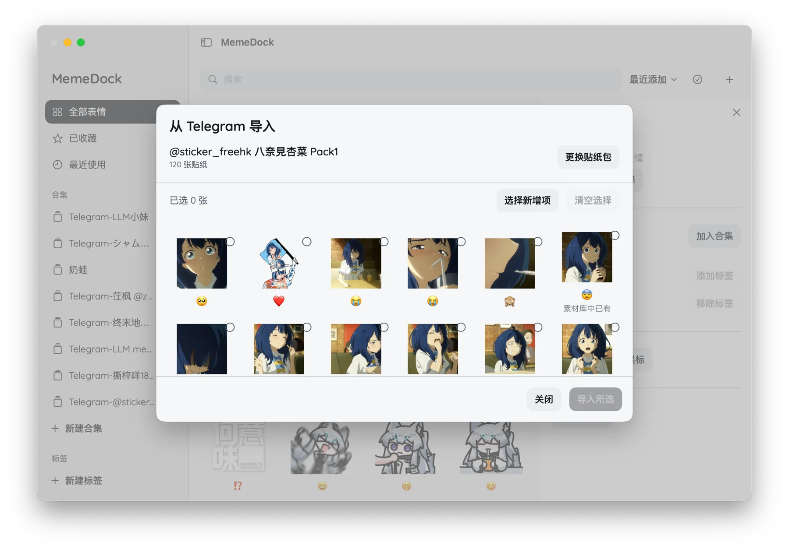
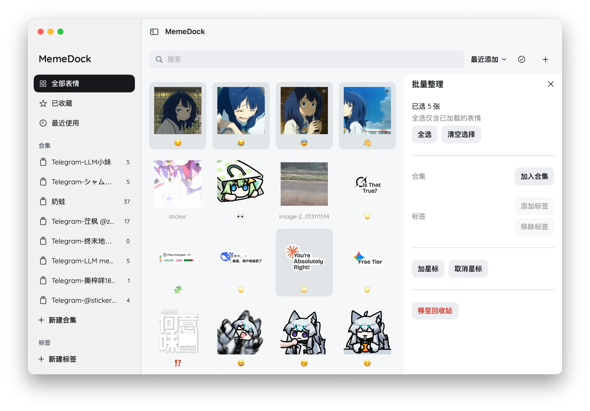
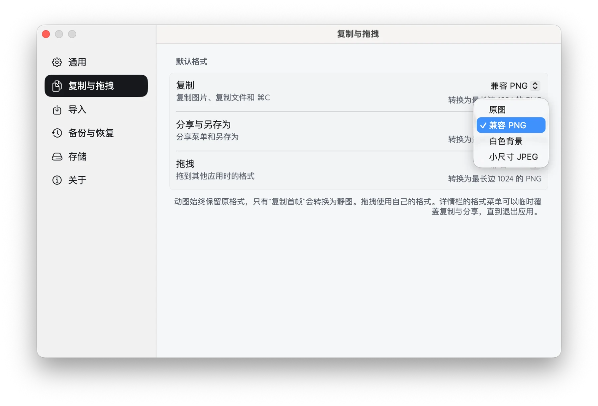
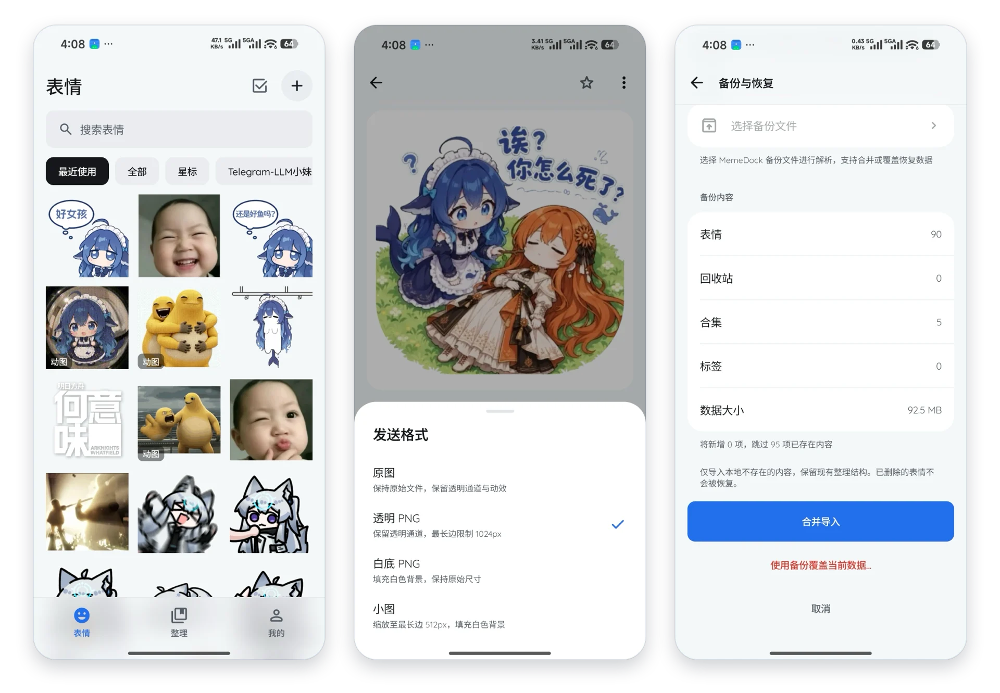

<div align="center">
  
  <h1>MemeDock</h1>
  <p><em>散落各处的表情与贴纸，安放于一处。</em></p>

  <p>
    <a href="https://github.com/grtsinry43/MemeDock/releases"></a>
    <a href="LICENSE"></a>
    
    
  </p>

  <p>
    <a href="README.md">English</a> · <strong>简体中文</strong>
  </p>
</div>

MemeDock 是一款本地优先的跨平台表情管理工具。它基于共享的 Rust 核心引擎与各平台原生界面构建，将不同来源的静图与动图收纳进统一的本地图库，让收藏、整理与日常分享回归简单自然。

<div align="center">
  
</div>

## 功能特性

- **多源收纳** — 支持文件拖入、剪贴板粘贴、本地选取及 Android 系统分享接收；支持通过贴纸包名称或链接直接浏览并挑选 **Telegram 贴纸包**，自动将 `.tgs` 矢量动画与 `.webm` 视频贴纸转换为保留透明通道的动态 WebP。
- **井然有序** — 以合集、标签与星标梳理图库，支持自由拖拽排序、批量归类及按标题、备注、文件名或标签即时检索，并随日常使用自然浮现常用内容。
- **从容分享** — 原图始终完整保留。复制、拖拽或分享时，可按需生成**原图**、**兼容 PNG** (`1024 px`)、**白底 PNG** 或**小尺寸 JPEG** (`512 px`)；动图默认保留动效，亦可在需要静图时提取首帧。
- **本地长存** — 所有数据保存在本地设备，采用内容哈希 (`SHA-256`) 自动去重并配备可恢复回收站。支持将整个图库打包为单个备份文件，在恢复前预览内容，并按需选择增量合并或带安全快照的完整替换。
- **原生质感** — 底层共享一套内存安全的 Rust 引擎 (`#![forbid(unsafe_code)]`)，上层采用各系统原生界面呈现：macOS (**SwiftUI & AppKit**)、iOS (**SwiftUI**)、Linux (**GTK4 & Libadwaita**)、Android (**Jetpack Compose**) 与 Windows (**WinUI 3**)，支持中英双语应用内即时切换。

## 界面预览

| Telegram 贴纸包导入 | 批量整理 |
| :---: | :---: |
|  |  |
| **复制与拖拽预设** | **Android 客户端** |
|  |  |

## 获取与安装

预编译安装包与 `SHA256SUMS` 校验清单发布于 [GitHub Releases](https://github.com/grtsinry43/MemeDock/releases)。

- **macOS (`arm64`)**：下载 `MemeDock-<version>-macos-arm64.dmg`（或 `.zip`），将 `MemeDock.app` 拖入应用程序目录。
- **Android (`arm64-v8a`)**：下载并安装 `MemeDock-<version>-android-arm64.apk`。
- **iOS (`arm64`，iOS 18+)**：下载 `MemeDock-<version>-ios-arm64-unsigned.ipa`，使用自己的 Apple 签名凭据签名后侧载到设备。
- **Windows (`x64`)**：解压 `MemeDock-<version>-windows-x64.zip`，运行 `MemeDock.Windows.exe`。
- **Arch Linux (`x86_64`)**：在 `packaging/arch/memedock-bin`（预编译）或 `packaging/arch/memedock-git`（源码）目录下执行 `makepkg -si`。
- **通用 Linux (`x86_64`)**：需 `gtk4 >= 4.22` 与 `libadwaita >= 1.9`：
  ```sh
  sudo tar --zstd -xf MemeDock-*-linux-x86_64.tar.zst -C /
  ```

## 架构与构建

```text
crates/domain     强类型标识、领域模型、导出规则与版本化契约
crates/storage    SQLite (SeaORM)、原子暂存区与内容寻址文件存储
crates/core       业务用例、任务调度、媒体转码管线、Telegram 与备份归档
crates/ffi        面向 Swift、Kotlin 与 C# 的 UniFFI 绑定及事件流
apps/*            android、ios、linux、macos 与 windows 原生客户端
```

```sh
# 工作区检查与测试
cargo fmt --all -- --check
cargo clippy --workspace --all-targets --locked -- -D warnings
cargo test --workspace --locked

# 各平台构建
cargo build --release --locked -p memedock-linux                        # Linux
bash tools/macos/build.sh release                                       # macOS (.app)
(cd apps/android && ./gradlew :app:testDebugUnitTest :app:verifyDebugBridge) # Android
bash tools/ios/build.sh release device                                  # iOS (无签名 .app)
pwsh tools/windows/build.ps1                                            # Windows
```

## 开源许可

本项目基于 [MIT 许可证](LICENSE) 开源。内置 Quicksand 字体遵循 [SIL Open Font License 1.1](apps/android/app/src/main/assets/font_licenses/quicksand-OFL.txt) 分发。
